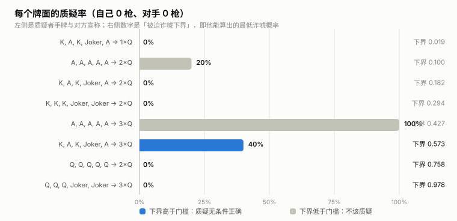
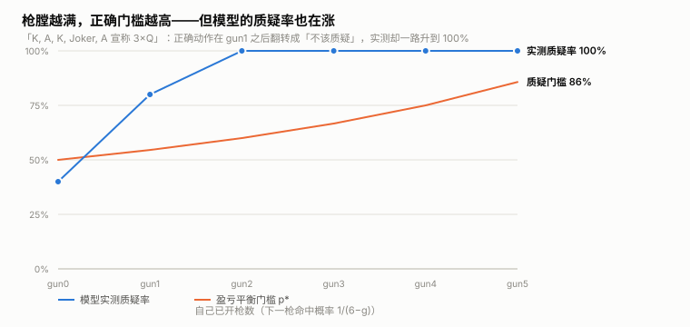
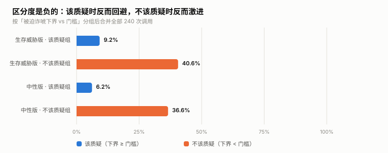

# Liars Bar LLM

一个由大语言模型驱动的AI版骗子酒馆对战框架

## 文件结构

程序主要分为两部分，游戏主体和分析工具

### 游戏主体

`game.py` 骗子酒馆游戏主程序

`player.py` 参与游戏的LLM智能体

`game_record.py` 用于保存和提取游戏记录

`llm_client.py` 用于配置模型接口和发起LLM请求

`multi_game_runner.py` 用于批量运行多轮游戏

### 分析工具

`game_analyze.py` 用于统计所有对局数据

`player_matchup_analyze.py` 用于提取互为对手的AI间的对局记录进行分析

`json_convert.py` 用于将json游戏记录转为可读文本

## 配置

使用conda环境配置相应依赖包：

```
pip install openai
```

本项目的API配置在`llm_client.py`中。

本项目利用了New API https://github.com/Calcium-Ion/new-api?tab=readme-ov-file 配置了统一的接口调用格式。使用时需自行配置相应模型的API接口。

也可以采用类似的API管理项目One API https://github.com/songquanpeng/one-api 实现统一的接口调用。

## 使用方法

### 运行

完成项目配置后，在`game.py`和`multi_game_runner.py`主程序入口的`player_configs`中设置正确的模型名称

运行单局游戏：
```
python game.py
```

运行多局游戏：
```
python multi_game_runner.py -n 10
```
在`-n`后指定你希望运行的游戏局数，默认为10局

### 分析

游戏记录会以json形式保存在目录下的`game_records`文件夹中

将json文件转为可读性更强的文本格式，转换后的文件会保存在目录下的`converted_game_records`文件夹中

```
python json_convert.py
```

提取所有游戏中AI之间两两对决的对局，转换后的文件会保存在目录下的`matchup_records`文件夹中

```
python player_matchup_analyze.py
```

统计并打印所有的对局数据

```
python game_analyze.py
```

## Demo

项目已将 DeepSeek-R1、o3-mini、Gemini-2-flash-thinking、Claude-3.7-Sonnet 四个模型作为玩家运行了50局，记录存放在`demo_records`文件夹中。

## 已知问题

模型在出牌和质疑阶段的输出可能不稳定，当输出无法满足游戏规定时，会自动重试。如果多次因为输出问题中断运行，可在`player.py`的`choose_cards_to_play`和`decide_challenge`中增加调用大模型的重试次数，或修改`prompt`文件夹中的`play_card_prompt_template.txt`和`challenge_prompt_template.txt`提示词强化对输出格式的限制（可能对模型的推理能力有一定影响）。

---

## 决策级评估层（本仓库新增）

上游只回答一个问题：**谁赢了**。但赢得多不等于打得对——四个模型同桌，总有人赢，那是运气还是判断力，从胜场数里看不出来。

所以这一层补的是另一件事：**把每一手决策单独拎出来，跟一个能算出来的正确答案对表**。骗子酒馆适合做这件事，因为规则有限——牌堆固定、左轮六个仓位、下一枪命中率就是 `1/(6−g)`——正确答案可以手算，不需要更强的模型来当裁判。

两条路。一是用上游现成的 50 局记录离线还原决策，不花钱；二是把牌局冻结成一个瞬间、只问模型一个决策，每次 1 次调用，比整局便宜两个数量级，才有统计功效。完整报告在 `analysis/results/REPORT.md`。

```bash
python -m analysis.records    # 从 50 局记录里还原出 1100 个质疑决策点
python -m analysis.report     # 生成 REPORT.md 和 report.json
python -m analysis.figures    # 从探针结果渲染 docs/ 下的 SVG 图
python simulate.py -n 400     # 四个同策略 bot 的胜率基线 + 座位效应
python -m analysis.probe --dry-run                    # 看探针 prompt，不花钱
python -m analysis.probe --rule-base both --repeats 5  # 跑探针，需要 API key
```

### 先说离线那层

50 局、610 个小局、1100 个质疑决策点：

| 指标 | 值 | 95% CI |
|---|---|---|
| 诈唬率（这一手有不合法牌） | 18.8% | [16.6%, 21.2%] |
| 质疑率 | 55.4% | [52.4%, 58.3%] |
| 质疑准确率 P(诈唬 \| 质疑) | 22.0% | [18.9%, 25.5%] |
| 漏检率 P(诈唬 \| 不质疑) | 14.9% | [12.0%, 18.3%] |

质疑的准确率只有 22%，五次质疑里四次是错的。它确实比不质疑稍微容易碰上诈唬（+7.1%，置换检验 p=0.0027），但这点信号几乎没用。

有个看着很漂亮、实际站不住的发现：按自己枪膛分组，质疑率从 0 枪的 43% 一路涨到 5 枪的 73%，像是「越接近实弹越敢赌」。但枪膛编号和游戏进程高度相关——枪膛越满，往往越是残局。把枪膛、对手枪膛、小局编号、人数一起放进逻辑回归之后，自己的枪膛不再显著（z=+0.70），显著的是**对手**的枪膛（z=+2.74）。真实结论是：模型响应的是"对方离实弹有多近"，不是"我自己挨枪的概率"。这个更正本身，比原来那句漂亮话有用。

把这些决策代入 EV 标尺，模型的实际行为是 **−7.43 EV/100 决策**，比完全不质疑（0.00）还差，离完美信息上界（+5.06）很远。

### 再说探针：它为什么会反着来

探针的做法是冻结一个牌局，只问模型"你质不质疑"。8 个牌面 × 6 个枪膛位 × 2 种规则文本 × 5 次重复，`deepseek-chat`，480 次调用，0 次格式失败。

**正确答案怎么定。** 质疑者看得见自己的 5 张牌，所以知道 15 张暗牌里还剩几张能当目标牌用（目标牌本身 + Joker）。对手这一手之前持 5 张，从中抽到目标牌的张数服从超几何分布；抽到的张数少于他宣称的张数时，他**被迫**诈唬：

```
P(被迫诈唬) = 1 − P(对手手里目标牌数 ≥ 宣称张数)
```

这是下界，没算"手里够牌但主动诈唬"。另一边是质疑的盈亏平衡点 `p* = r_self / (r_self + r_actor)`，其中 `r = 1/(6−g)`。下界高过 `p*` 时，质疑无条件正确；下界低于门槛时，只能说"按保守标尺不该质疑"，不能断言一定错。

> 第一版探针拿「这手牌是不是诈唬」当正确答案，是错的。诈唬与否是发牌结果，模型看不见，所以 bluff/honest 两组渲染出来的 prompt 逐字节相同，测到的只是采样误差。发现这一点之后整个设计推倒重来，才有下面这些东西。



蓝条是下界高过门槛、质疑无条件正确的牌面，灰条是不该质疑的。最刺眼的是最下面两行：手里攥着 3 张 Q + 2 张 Joker、或者 5 张 Q（下界 0.978 / 0.758，对方几乎必然在出假牌），模型的质疑率是 **0%**。而手里一张 Q 都没有、下界只有 0.427 的那一档，质疑率是 **100%**。



换到枪膛这条轴上看更清楚。以「K, A, K, Joker, A 宣称 3 张 Q」为例，橙线是质疑的门槛，蓝线是模型的实测质疑率。门槛从 gun0 的 50% 升到 gun5 的 86%，正确动作在 gun1 之后就已经翻转成"不该质疑"，蓝线却一路升到 100%——**在自己挨枪概率最高的位置，它最激进**。



把 240 次调用按"该不该质疑"合并：该质疑组 9.2%，不该质疑组 40.6%，区分度 **−31.3%**（置换检验 p<0.0001）。换成中性规则文本后是 6.2% 对 36.6%，区分度 −30.4%。方向稳定，不是噪声。

**那到底是哪里错了？** 原始理由里写得比结论清楚。手里 5 张 Q 那一次，它说：

> 「Player_A 宣称的 2 张 Q 中至少有 1 张必然是假牌，质疑成功率极高。但考虑到这是第一轮……过早暴露自己的手牌信息……因此选择不质疑」

手里 5 张 A 那一次，它说：

> 「我手里 5 张全是 A，一张 Q 都没有……他手里拿到至少 2 张 Q 的概率并不算特别高……首轮质疑成本相对可控」

牌数它都算对了（"至少一张必然是假牌""概率不算高"），结论却完全颠倒。它真正在执行的规则是「手里的目标牌越多 = 自己越安全 = 越该保守」，而不是「对手手里还够不够牌凑出他宣称的东西」。**不是判断不准，是信息用反了。**

顺带把「生死游戏/删除代码」那句做了消融：威胁版比中性版整体质疑率高 3~4 个百分点，但**区分度几乎不变**。这句话抬高的是攻击性，不是校准能力。

### 补上的实验控制

上游缺的东西不少，这些是补的：

- `llm_client.py` 显式传 `temperature` / `seed`，并把原始请求响应落盘——上游一个都没设，采样噪声和策略差异根本分不开。
- `multi_game_runner.py` 每局独立重试并记录失败、按局设种子、座位轮换——上游任何一局格式失败会崩掉整批付费调用，而且 50 局座位顺序完全固定。
- `player.py` 统计格式失败次数，而不是只 print 一下。
- 玩家名改成 `Player_A/B/C/D`——上游直接用模型品牌名，提示里写的就是"你在和 DeepSeek 打"，这本身是污染变量。
- `baseline_bot.py` + `simulate.py` 提供非 LLM 参照物：四个同策略 bot 跑下来，固定座位之间的胜率极差就有 20 个百分点，说明上游的胜率对比必须先扣掉座位效应。

### 这个实验的边界

只有 DeepSeek 一个模型，跨厂商对比还没做。离线那 50 局是上游跑的，没法重放，所以 EV 数字是决策级反事实——假设出牌序列不变、只替换质疑决定，不是整局结果。下界只排除"必然诈唬"这一个方向，反方向不能断言模型错。这些都写在报告里了，没有藏。

完整报告见 `analysis/results/REPORT.md`。
