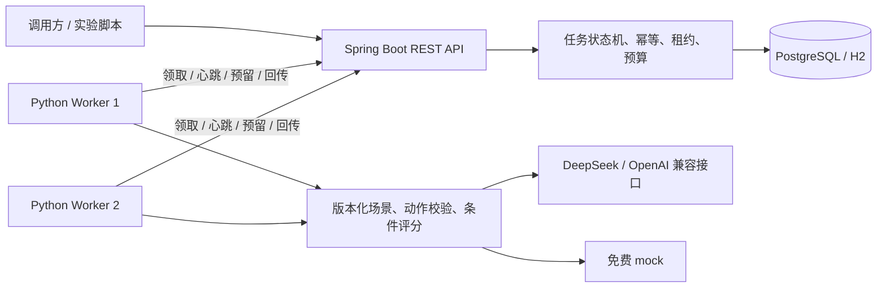

# Liars Bar Agent Eval

**基于 Spring Boot 的 LLM Agent 评测任务平台，支持调用预算、故障接管与断点恢复。**

Java 21 · Spring Boot 3.5 · PostgreSQL · Python · Docker Compose

[项目概况](#项目概况) · [核心设计](#核心设计) · [快速启动](#快速启动) · [接入 DeepSeek](#接入-deepseek) · [实验与验证](#实验与验证) · [文档导航](#文档导航)

## 项目概况

Liars Bar Agent Eval 以骗子酒馆的隐藏信息决策为评测场景，将“准备场景、调用模型、校验动作、统计结果”组织成可持久化、可恢复的后台任务。

批量模型评测会遇到重复提交、请求超时、进程退出、费用失控和结果难以复现等问题。本项目将任务管理与模型执行分离：**Spring Boot 负责状态和一致性，Python Worker 负责模型调用与判分**，通过 REST 协议完成领取、续租、预算预留和结果回传。

一次任务的完整流程是：

> 提交评测配置 → 生成确定性样本 → Worker 领取任务 → 预留调用预算 → 请求模型 → 校验动作 → 保存检查点 → 查询报告

平台提供 REST API、命令行实验工具和可复现图表，适合演示异步任务调度、数据库并发控制，以及 LLM 应用中的失败处理与实验追溯。

### 核心能力

| 能力 | 实现方式 | 解决的问题 |
|---|---|---|
| 幂等提交 | `Idempotency-Key`、规范化配置哈希与唯一约束 | 客户端重试不会创建重复任务；同键不同配置返回 409 |
| 持久化任务 | `run → case → attempt` 数据模型与显式状态机 | 任务进度、失败和调用历史能够独立查询与恢复 |
| 预算控制 | 调用前预留 attempt，事务与行锁保护计数 | 单样本与整批任务均有调用上限，重启不重置预算 |
| 故障接管 | 租约、后台心跳与 token 校验 | Worker 退出后可接管，旧 Worker 无法覆盖新结果 |
| 检查点恢复 | case 终态与结果在事务中落库 | 接管或恢复任务时跳过已完成样本 |
| 可追溯报告 | 原始 prompt / 响应、源码指纹、模型名、usage 与延迟 | 能从聚合指标定位到具体输入、输出和执行版本 |

## 核心设计



- **事务范围**：数据库事务只覆盖领取、预算与结果写入；模型 HTTP 请求在事务外执行。
- **并行粒度**：多个 Worker 并行执行不同任务，同一任务同时只有一个有效租约持有者。
- **去重边界**：任务创建、调用预留、结果回传分别保证本地幂等。模型已回答但 Worker 未回传时，无法保证供应商只执行一次；未知 attempt 保留预算占用。
- **部署形态**：一个 Spring Boot 应用、独立数据库和可增加实例的 Python Worker。数据库协调任务领取，当前规模无需引入额外消息中间件。

技术栈：

| 层次 | 技术与职责 |
|---|---|
| Java 后端 | Java 21、Spring Boot 3.5.7、Spring MVC、Bean Validation、统一异常处理 |
| 数据与事务 | Spring JDBC / JdbcTemplate、PostgreSQL 16、H2、Flyway、HikariCP |
| 评测执行 | Python 3.11、OpenAI 兼容 SDK、严格 JSON 动作契约、分类重试 |
| 部署与验证 | Docker Compose、Actuator 健康检查、JUnit / MockMvc、Python unittest、GitHub Actions 配置 |
| 数据展示 | Matplotlib、SVG / PNG、带来源 SHA-256 的绘图数据 |

详细的分层、任务状态机、并发时序与取舍见 [架构说明](docs/architecture.md)。

## 快速启动

### 1. 启动 Docker 服务

需要 **Docker Desktop / Docker Engine 与 Compose v2**。Java、Maven、Python 均由镜像提供；运行免费示例不需要模型 API Key。以下命令使用 PowerShell，在仓库根目录执行。

```powershell
git clone https://github.com/liveover-yu/liars-bar-agent-eval.git
cd liars-bar-agent-eval

# 已有 .env 时保留原配置
if (-not (Test-Path .env)) { Copy-Item .env.example .env }
docker compose up --build -d --scale worker=2
docker compose ps
```

Compose 启动 PostgreSQL、Spring Boot 和两个 Worker。首次启动需要拉取镜像和安装依赖；等待服务就绪后检查：

```powershell
Invoke-RestMethod http://127.0.0.1:8080/actuator/health
# 预期：status 为 UP
```

API 地址为 `http://127.0.0.1:8080`。数据库保存在命名卷中；`docker compose stop` 停止服务，`docker compose up -d --scale worker=2` 再次启动。

默认配置使用本地开发密钥。若修改了 `.env` 中的 `LIARS_CONTROL_API_KEY`，下方请求头也需同步修改。镜像拉取受限或已有 jar 时，可使用 [预打包构建入口](docs/docker-verification.md#本次实际构建入口)。

### 2. 完成一次免费评测

容器中的 Worker 会自动领取任务。复制以下代码，创建 6 个样本的 mock 任务，并等待报告：

```powershell
$headers = @{
  'X-API-Key' = 'local-dev-key-change-me'
  'Idempotency-Key' = [guid]::NewGuid().ToString()
}
$body = @{
  mode = 'mock'
  boards = @('QQJ_3')
  repeats = 1
  seed = 42
  maxAttempts = 1
  maxCalls = 6
} | ConvertTo-Json

$run = Invoke-RestMethod -Method Post `
  -Uri 'http://127.0.0.1:8080/api/runs' `
  -Headers $headers -ContentType 'application/json' -Body $body

$deadline = (Get-Date).AddSeconds(60)
do {
  $state = Invoke-RestMethod `
    -Uri "http://127.0.0.1:8080/api/runs/$($run.runId)" -Headers $headers
  if ($state.status -in @('SUCCEEDED', 'FAILED', 'CANCELLED')) { break }
  Start-Sleep -Seconds 1
} while ((Get-Date) -lt $deadline)

Invoke-RestMethod `
  -Uri "http://127.0.0.1:8080/api/runs/$($run.runId)/report" -Headers $headers
```

正常完成时，报告包含 `status=SUCCEEDED`、`totalCases=6`、`successCases=6`、`callCount=6`、`totalTokens=0`。mock 使用固定种子的模拟动作，验证完整执行链路，不访问模型供应商。

### 3. 查询、取消与恢复

| 操作 | 接口 |
|---|---|
| 创建 / 列出任务 | `POST /api/runs` · `GET /api/runs` |
| 查询状态 | `GET /api/runs/{runId}` |
| 分页结果 / 聚合报告 | `GET /api/runs/{runId}/results` · `GET /api/runs/{runId}/report` |
| 取消 / 恢复 | `POST /api/runs/{runId}/cancel` · `POST /api/runs/{runId}/resume` |

所有 `/api/**` 请求携带 `X-API-Key`。恢复要求存在未完成样本及剩余预算；已完成的成功、失败检查点和预算计数都会保留。请求结构与错误码见 [接口说明](control-plane/README.md) 和 [OpenAPI 契约](control-plane/openapi.yaml)。

<details>
<summary>本机开发：Spring Boot + H2 + Python Worker</summary>

需要 JDK 21、Maven 3.9+、Python 3.11+。在仓库根目录执行；若 Docker 栈已占用 8080，先运行 `docker compose stop`。

```powershell
python -m venv .venv
.\.venv\Scripts\python.exe -m pip install -r requirements.txt
mvn -f control-plane/pom.xml verify

$env:LIARS_CONTROL_API_KEY = 'local-dev-key-change-me'
java -jar control-plane/target/liars-eval-control-plane-0.1.0.jar
```

新终端进入同一目录，启动 Worker：

```powershell
$env:LIARS_CONTROL_API_KEY = 'local-dev-key-change-me'
.\.venv\Scripts\python.exe -m eval_worker --server http://127.0.0.1:8080
```

接着执行上面的免费任务示例。默认 H2 文件写入启动目录的 `data/`，重启时使用同一工作目录。原生 Java / Python 不自动读取 `.env`，需要使用环境变量。Linux / macOS 将 Python 路径替换为 `.venv/bin/python`，环境变量使用 `export`。

</details>

## 接入 DeepSeek

在运行 Compose 的终端中设置凭证，并更新 Worker 环境；应用密钥与模型供应商密钥是两套不同配置：

```powershell
$env:LIARS_API_BASE_URL = 'https://api.deepseek.com'
$env:LIARS_API_KEY = '<你的 DeepSeek API Key>'
docker compose up -d --no-build --no-deps --force-recreate --scale worker=2 worker
```

也可以将这两项写入 `.env` 后执行相同命令。Shell 中的同名环境变量优先于 `.env`。供应商凭证仅保存在 Worker 环境，不进入任务请求与 Java 数据库。

配置 Key 不会自动调用模型。普通任务显式设置 `mode='llm'`、`model='deepseek-chat'` 后才访问供应商。使用本机 Worker 时，在它的启动终端设置相同变量即可。

仓库提供两组规则、总上限 96 次调用的实验脚本。运行客户端脚本需要本机 Python 3.11+，这份脚本只使用标准库：

```powershell
# 默认只打印实验计划，不调用模型
python scripts/run_model_experiment.py

# 实际执行：产生供应商消耗；目录已存在时拒绝覆盖
python scripts/run_model_experiment.py --execute `
  --out-dir analysis/experiments/deepseek-v2-rerun-001
```

脚本通过 Java API 创建任务，容器中的 Worker 完成调用，随后导出配置、逐样本原始结果和聚合报告。若更改过控制面密钥，运行客户端前也需设置对应的 `LIARS_CONTROL_API_KEY`。

## 实验与验证

### 后端执行验证

| 验证 | 实测结果 |
|---|---|
| Java 集成测试 | 17 项通过，覆盖并发领取、幂等、预算竞争、租约与终态约束 |
| Docker mock 联调 | 8 个任务、72 个成功样本，538 项验收断言通过 |
| 调用上限 | `maxCalls=1` 的任务在一次预留后按预期停止 |
| 多 Worker 与持久化 | 两个 Worker 都实际领取任务；PostgreSQL 和 Java 重启后 9 个任务的数据保持 |

Docker 实测采用预打包 jar 与已准备的兼容基础镜像，命令、构建路径和证据位置见 [Docker 验收记录](docs/docker-verification.md)。这些数字是本地功能与故障验证，未作为生产吞吐指标。

### 本项目采集的 DeepSeek 实验

2026-11-18，通过 Java 控制面和两个 Docker Worker，执行 `probe-v2` 的 8 牌面 × 6 枪膛状态。两套规则每状态各调用一次，无重试，共 96 次调用。请求名为 `deepseek-chat`，供应商返回模型字段为 `deepseek-flash`。

| 规则文本 | 有效结果 / 计划样本 | 格式失败 | 有效响应参考一致率 |
|---|---|---|---|
| 中性规则 | 47/48 | 1 | 22/47 = 46.8% |
| 生存威胁规则 | 48/48 | 0 | 18/48 = 37.5% |


每次响应的输入、原始输出、错误、源码指纹、usage 和延迟均已保存。格式失败未被补跑替换；任务执行状态与动作质量分别报告。

评分采用公开生成假设下的单步效用参考，不等于整局胜率。全量套件的“永不质疑”基线为 35/48（72.9%）；只比较中性规则的有效子集时，基线为 35/47（74.5%）。本次模型结果均未超过对应基线，每状态仅一次采样，作为初步实验保留。完整分母、任务 ID 与原始材料见 [实验报告](docs/evaluation-results.md)，推导和适用范围见 [评测方法](docs/evaluation-methodology.md)。

<details>
<summary>运行自动验证与重绘实验图表</summary>

本机开发环境准备完成后执行：

```powershell
mvn -f control-plane/pom.xml verify
.\.venv\Scripts\python.exe -m unittest discover -s tests -v
.\.venv\Scripts\python.exe -m unittest discover -s practice/offline_table/tests -v
.\.venv\Scripts\python.exe scripts/smoke_platform.py
```

`smoke_platform.py` 使用随机端口、临时数据库和独立应用密钥，实际启动并重启 Java，验证 Python 补齐检查点。Docker 栈已启动时，也可直接运行标准库客户端：

```powershell
python scripts/smoke_compose.py
```

重新绘制已采集的数据，不调用模型：

```powershell
.\.venv\Scripts\python.exe -m pip install -r requirements-viz.txt
.\.venv\Scripts\python.exe scripts/plot_evaluation.py `
  --experiment-dir analysis/experiments/deepseek-v2-20261118
```

输出包含 SVG、PNG 与来源指纹。重新生成中文图表需 Microsoft YaHei 或 Noto CJK 等字体；浏览已导出的 SVG 无需安装字体。GitHub Actions 配置覆盖 Python、Java 与 H2 / PostgreSQL 联调，运行状态以实际 Actions 记录为准。

</details>

## 项目结构

```text
control-plane/            Spring Boot API、任务状态机、事务与 Flyway 迁移
eval_worker/              任务领取、心跳、模型调用、分类重试与回传
contracts/                版本化场景与跨语言 case 契约
analysis/                 条件参考策略、探针与离线分析工具
  experiments/            本项目新采集的配置、报告与原始响应
scripts/                  联调验收、实验采集和图表生成
docs/                     架构、评测方法、验收记录与图表
tests/                    Python 回归与故障注入测试
docker/                   Java / Python 构建入口
compose.yaml              PostgreSQL + Spring Boot + Worker 部署
```

## 文档导航

| 文档 | 内容 |
|---|---|
| [架构说明](docs/architecture.md) | Agent 与后端架构、事务边界、状态机、租约接管与故障语义 |
| [控制面说明](control-plane/README.md) | 配置、API、幂等与错误处理 |
| [OpenAPI 契约](control-plane/openapi.yaml) | 请求、响应和接口结构 |
| [评测方法](docs/evaluation-methodology.md) | 场景假设、概率推导、参考基线、指标分母与统计边界 |
| [实验报告](docs/evaluation-results.md) | 本项目采集的数据、原始材料、图表与复现命令 |
| [Docker 验收记录](docs/docker-verification.md) | 实际构建入口、双 Worker 联调与重启验证 |

## 项目来源与实现范围

项目在既有骗子酒馆 LLM 游戏代码上扩展。原有游戏、玩家反思、提示词与示例记录继续保留；新增工作集中在 Spring Boot 任务控制面、持久化执行协议、Python Worker、版本化条件评测、容器部署及本项目采集的实验。旧示例日志的玩家成绩不进入当前展示。

当前 Java 平台调度单步条件探针，完整对局仍通过原有 Python 入口运行。后续方向包括整局任务接入、供应商统一限流、实验版本约束和更充分的重复实验。

代码采用 [Apache License 2.0](LICENSE)。
