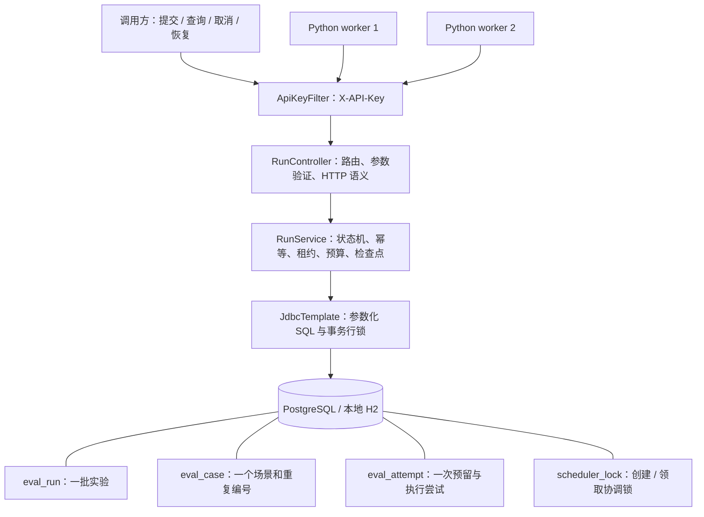
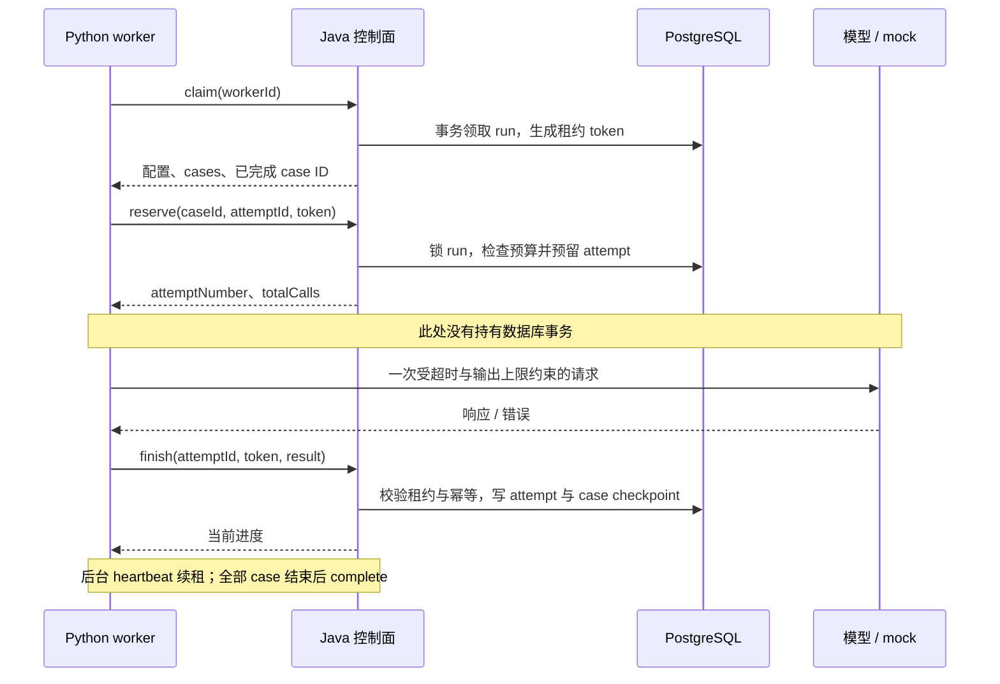
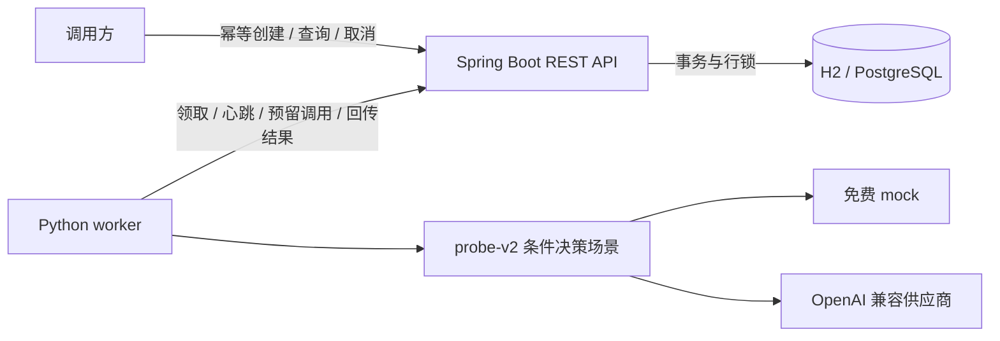
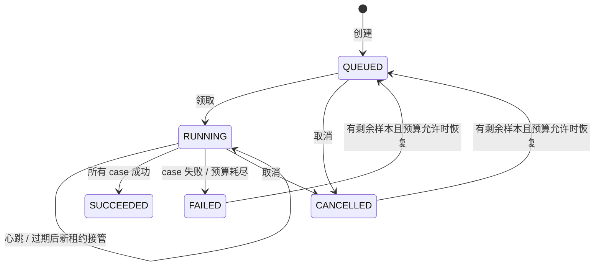

# Java 任务控制面与 Python 评测执行

这版改造解决的是批量评测的执行问题：任务不能只存在循环变量中，模型调用不能因进程重启而无限重试，旧 worker 也不能覆盖接管者的结果。

## Agent 架构：游戏决策与单步评测

当前项目有两条明确的执行路径。原有完整游戏是规则环境驱动的多智能体博弈：多个 `Player` 在同一 `Game` 中轮流行动，每个玩家只收到自己的手牌和规则允许的可见信息。新增 Java 平台调度的是独立的单步探针，每个 case 固定一个状态，只请求一次“是否质疑”的决策；样本之间不共享对话或反思记忆。

```mermaid
flowchart TB
    subgraph GAME["完整游戏：规则驱动的多 Agent 决策闭环"]
        ENV["Game：手牌、轮次、目标牌、枪膛"] --> OBS["构造玩家可见状态"]
        MEM["当局文本记忆：对手印象 opinions"] --> OBS
        OBS --> POLICY["Player：出牌 / 是否质疑"]
        POLICY --> CLIENT["LLMClient：模型请求"]
        CLIENT --> VALID["结构校验与手牌数量校验"]
        VALID --> ACT["执行动作：判真伪、罚枪、淘汰"]
        ACT --> RECORD["GameRecord：状态变化和反馈"]
        RECORD --> ENV
        RECORD --> REFLECT["小局结束后反思"]
        REFLECT --> MEM
    end
    subgraph PROBE["Java 平台当前调度：单步条件决策评测"]
        CASE["probe-v2 场景与公开假设"] --> INPUT["规则、可见状态、固定 seed"]
        INPUT --> CALL["一次模型调用 / 免费 mock"]
        CALL --> PARSE["parse_action：严格 JSON 契约"]
        PARSE --> EVAL["参考一致率、错误、延迟、token"]
    end
```

`Player` 的记忆是当局内的对手印象文本，由 `reflect()` 根据一轮的行动与结果更新，再用于后续决策。它没有跨任务向量记忆、工具注册或自主规划执行循环。`GameRecord` 保存完整实验记录，但生成玩家观察时按视角隐藏未公开牌面。

探针的参考动作由可计算概率和单步效用门槛产生，判分条件直接写入模型输入。worker 的 checkpoint 用于恢复执行进度，与 Agent 的语义记忆是不同的数据。完整游戏入口仍为 Python CLI，当前 Java 任务类型尚未接入整局对战。

| 需求 | 实际代码入口 |
|---|---|
| 完整游戏调度与环境反馈 | `game.py`：`start_game`、`play_round`、`handle_challenge` |
| 策略决策与当局反思 | `player.py`：`choose_cards_to_play`、`decide_challenge`、`reflect` |
| 观察视角与日志 | `game_record.py`：`RoundRecord`、`GameRecord` |
| 条件评测场景与参考动作 | `analysis/probe.py`、`analysis/risk.py` |
| 单步执行与错误分类 | `eval_worker/decisions.py`：`CaseEvaluator` |
| 任务恢复与续租 | `eval_worker/runner.py`：`Worker`、`LeaseGuard` |

## Java 后端：分层、数据与调用时序

Java 服务负责任务状态、预算、租约和结果一致性。Python worker 负责可能耗时较长的模型调用；调用期间保持后台心跳，数据库事务不会跨越模型 HTTP 请求。

当前是一个 Spring Boot 应用，Service 直接使用 JdbcTemplate，没有独立 Repository 层。`Protocol` 的 Java record 定义 HTTP 契约，Flyway 负责表结构迁移，健康检查通过 Actuator 暴露。

业务关系为 `run 1:N case 1:N attempt`。例如选择一个牌面、六种枪膛状态、重复两次，会生成十二个 case；其中一个 case 超时后重试成功，会留下两个 attempt。最终 case 的 checkpoint 指向终结该 case 的 attempt，保留之前失败或未知结果的尝试。

多 worker 当前并行执行不同 run；同一 run 同时只有一个租约持有者。任务领取、预算预留和结果落库的约束见下文。

## 为什么任务队列放在数据库

任务配置、case 列表、种子、调用预留次数、租约和结果都需要一起提交。第一版直接使用数据库事务作为一致性边界，每个 run 同时只有一个 worker，多个 worker 并行执行不同 run。新增 Redis 或消息队列并不能替代这套状态约束。

领取时锁定调度协调行，再选择排队任务或租约已过期的任务；领取后生成新的随机 token。预留调用、续期、回传和终结任务都锁定 run 行，检查状态、token 和租约截止时间。事务仅包住数据库操作，模型 HTTP 请求在 Python 进程执行。

协调行让 H2 与 PostgreSQL 使用同一套可验证的领取语义，但会串行化领取与创建；它适合当前项目规模。扩大调度吞吐前应以真实压测定位瓶颈，再考虑 PostgreSQL `SKIP LOCKED` 与分片领取。

## 状态和恢复

已完成的 case 是持久化检查点。worker 接管任务时收到完整 case 清单与 `completedCaseIds`，只执行尚未完成的样本。恢复保留调用预算、attempt 历史和已经完成的失败样本；重新评测已失败样本需要创建新任务。

## 三种不同的幂等边界

| 边界 | 机制 | 保证范围 |
|---|---|---|
| 创建任务 | `Idempotency-Key` + 规范化配置哈希 + 唯一约束 | 同键同配置返回同一任务，不同配置返回 409 |
| 预留一次调用 | worker 生成 `attemptId`，HTTP 重试复用相同 body | 重放不会重复扣减调用预算 |
| 回传结果 | attempt 的完成内容哈希 + case 检查点 | 同一完成结果重放不重复计 token，也不重复生成 case 结果 |

这不是供应商请求的 exactly-once 保证。模型已经回答、worker 却在回传前崩溃时，控制面无法知道供应商是否计费。该 attempt 仍占用预算；如果还有额度，接管者可能再次调用。这是有界的 at-least-once 执行，报告用 `unfinishedAttempts` 显示未知结果，不能把未知消耗当成零。

## 调用预算和错误分类

每次执行前先预留一个 attempt，`callCount` 表示累计预留次数。`maxCalls` 限制整个 run，`maxAttempts` 限制单个 case，取消和重启不会重置这些计数。mock 也走同一状态机，但不产生供应商 token 消耗。

worker 把 SDK 隐式重试设为零，由外层在每次预留后进行一次调用。格式错误、限流、超时、网络错误可以在预算内重试；鉴权和不可重试的供应商参数错误直接记录为失败。指数退避有上限，后台心跳独立于模型请求。取消后最多等待正在执行的一次请求超时，旧租约回传会被拒绝。

`maxOutputTokens` 限制单次生成上限，当前没有实现按价格表计算的人民币/美元硬预算。`totalTokens` 只统计供应商实际回传且已持久化的 usage，无法估算未回传请求的真实账单。

## 实验可追溯性

任务固定模型请求名、temperature、种子、规则文本、样本顺序和 suite 版本；每个 attempt 保存 prompt 指纹、原始响应、供应商返回的模型版本、延迟、usage、错误类别。worker 同时回传原始 prompt、供应商 request ID 和执行源码指纹，便于在源码变更后复核请求。

当前控制面会校验套件版本与 prompt 哈希，但尚未按 run 强制锁定 worker 源码指纹。同一实验应使用相同源码的 worker；升级执行或判分代码时应创建新任务，改变评测语义时应提升 suite 版本。原始 prompt 与逐次源码指纹可用于检查是否混入不同版本。

`probe-v2` 有明确的外生出牌张数、诚实优先与单步效用假设。报告里的 `agreementWithReference` 只表示这些假设下的参考一致率。mock 报告验证执行链路；历史 v1 探针与真实整局胜率不能与它直接混算。详见 [评测方法](evaluation-methodology.md)。

## 当前交付边界

默认 H2 文件数据库便于单机运行，使用 `WRITE_DELAY=0` 使已经确认的提交在进程强制停止后仍可恢复；自定义 H2 URL 时也应保留此参数。PostgreSQL profile 和 Compose 用于独立数据库部署。租约判断使用服务端时钟，多控制面实例需要同步时钟。当前应用密钥是本地开发和受控环境的接口保护，未实现租户隔离、用户权限体系或公网网关。

提供 Java 并发与事务测试、Python 故障注入测试，以及真实启动 Java、重启同一数据库、由 Python 补齐检查点的 smoke 脚本。没有生产流量、吞吐提升或线上稳定性指标，后续简历应以这些实际机制与验证结果描述项目。
