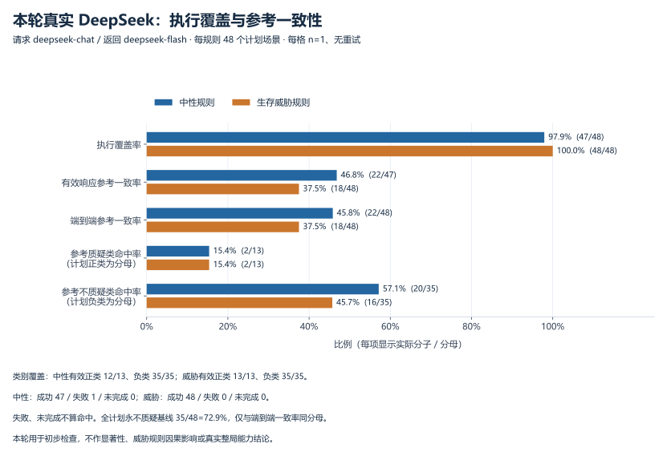
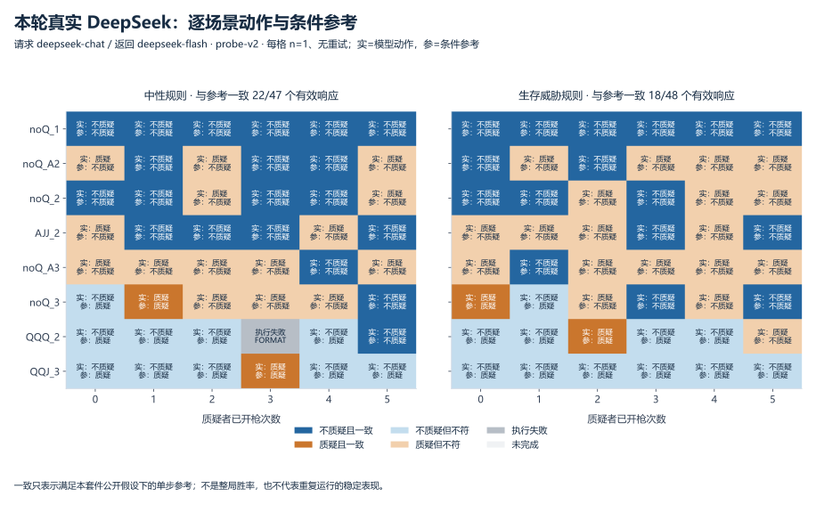
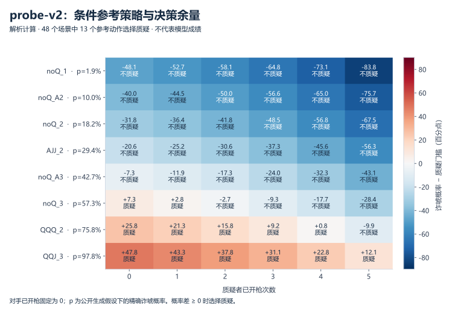

# 本轮执行验收与模型实验

本页只展示本轮执行验证和新任务产生的结果。仓库原有示例日志继续保留用于追溯，其玩家成绩与旧探针统计已从本页撤下。

## 1. 已完成的执行系统验收

| 检查 | 本轮已验证结果 |
|---|---|
| 容器部署 | PostgreSQL 16、Java 21 / Spring Boot、两个 Python worker |
| mock 正常执行 | 8 个任务成功，72 个样本完成 |
| 数据断言 | 538 项检查通过，覆盖幂等、唯一检查点、调用次数、prompt 与来源指纹 |
| 调用预算 | 额外的 `maxCalls=1` 任务预留 1 次调用后按预期失败 |
| 并行 worker | 两个不同 worker 都实际领取任务 |
| 重启持久化 | PostgreSQL 和 Java 重启后，9 个任务的状态与计数保持一致 |

以上任务使用 `mock`，没有供应商调用。它们验证任务协议、预算与数据库恢复，不能说明真实模型的动作质量、推理延迟或生产吞吐。构建入口、验收脚本与本地证据位置见 [Docker 验收记录](docker-verification.md)。

## 2. 本轮真实模型实验

<!-- REAL_MODEL_RESULTS_START -->
执行时间为 **2026-11-18 00:17:53—00:20:12（Asia/Shanghai）**。通过正在运行的 Spring Boot、PostgreSQL 和两个 Docker Worker 提交并执行两组 `mode=llm` 任务，供应商地址为 `api.deepseek.com`。请求模型名是 `deepseek-chat`，96 次响应保存的 `modelVersion` 均为 `deepseek-flash`；这是供应商返回的标签，未提供更精确的版本快照。

### 配置与样本

- 套件 `probe-v2`，完整 8 牌面 × 6 枪膛状态，每种规则 48 个样本。
- `neutral` / `threat` 分别使用去掉 / 保留生存威胁首句的规则，其他计划条件相同。
- 每状态一次调用：`repeats=1`、`temperature=0`、base seed 42；Worker 按 case ordinal 展开为 42–89。
- 每任务 `maxCalls=48`、`maxAttempts=1`、`timeoutSeconds=60`、`maxOutputTokens=1024`，总调用上限 96。
- 每场景只有一次采样，没有模型质量置信区间，不将两个汇总分数之差解释为稳定的因果效应。

### 结果与分母

| 指标 | 中性规则 | 威胁规则 |
|---|---|---|
| Java 任务状态 | `FAILED`，一个最终格式错误 | `SUCCEEDED` |
| 已完成 checkpoint | 48/48 | 48/48 |
| 有效决策覆盖率 | 47/48 = 97.9% | 48/48 = 100% |
| 有效响应参考一致率 | 22/47 = 46.8% | 18/48 = 37.5% |
| 符合参考的有效结果 / 全部计划样本 | 22/48 = 45.8% | 18/48 = 37.5% |
| 参考质疑类命中 / 计划正类 | 2/13；有效正类为 12，另有 1 格式错 | 2/13 |
| 参考不质疑类命中 / 计划负类 | 20/35 | 16/35 |
| 有效响应中的质疑率 | 17/47 = 36.2% | 21/48 = 43.8% |
| 预留调用 / 已回传 attempt | 48/48 | 48/48 |
| 未知 attempt | 0 | 0 |
| 已回传 tokens | 51,683 | 51,946 |
| 单次 attempt p95 延迟 | 5,118 ms | 4,266 ms |

总计 **96 次调用、95 个有效动作、1 个格式错误、103,629 个已回传 tokens**。延迟包含单次 Worker 执行开销，统计所有已回传 attempt，含格式错误；不等于模型纯推理耗时。这里只报告 usage，不按未知价格表推算账单。

中性规则的失败样本为 `QQQ_2_gun3:0`，解析错误是“JSON 代码围栏不完整”。该响应保留在原始结果里，没有补跑替换，所以 Java 任务按协议标为 `FAILED`。实验的 `COMPLETED_WITH_ERRORS` 表示计划采集完毕且有错误，不把失败任务改成成功。供应商 request ID 没有回传，结果中为 `null`，不声称具有这部分追溯信息。





完整均匀套件的永不质疑基线为 `35/48 = 72.9%`。若只比较成功子集，中性规则的同分母基线是 `35/47 = 74.5%`，威胁规则为 `35/48 = 72.9%`；本轮模型两组均未超过。结果说明当前 prompt 与条件任务下的决策和参考有较多分歧，不推广为真实游戏胜率或模型整体能力结论。

### 原始材料与任务身份

| 条件 | run ID | 文件 |
|---|---|---|
| neutral | `aab03168-2c71-436a-aeec-0acce7129c2f` | [配置](../analysis/experiments/deepseek-v2-20261118/neutral/run.json)、[报告](../analysis/experiments/deepseek-v2-20261118/neutral/report.json)、[逐样本原始响应](../analysis/experiments/deepseek-v2-20261118/neutral/results.json) |
| threat | `113fa817-8b24-47dc-bd84-ac51a1168c88` | [配置](../analysis/experiments/deepseek-v2-20261118/threat/run.json)、[报告](../analysis/experiments/deepseek-v2-20261118/threat/report.json)、[逐样本原始响应](../analysis/experiments/deepseek-v2-20261118/threat/results.json) |

[实验清单](../analysis/experiments/deepseek-v2-20261118/experiment.json) 保存计划与时间，逐结果保存实际 prompt、原始响应文本、prompt hash、Worker 源码指纹、返回模型名、延迟与 usage。绘图使用 [chart-data.json](figures/chart-data.json) 保存精确分子分母和来源文件 SHA-256。

### 复现命令

仅重新绘制已完成实验，不调用 API：

```powershell
.\.venv\Scripts\python.exe -m pip install -r requirements-viz.txt
.\.venv\Scripts\python.exe scripts/plot_evaluation.py --experiment-dir analysis/experiments/deepseek-v2-20261118
```

重新采集需要已启动 Java / Worker，且 Worker 已配置模型凭证。配置凭证不会自动开始调用；默认任务为 mock，下面的 `--execute` 会明确创建 LLM 任务并产生供应商消耗：

```powershell
# 只查看 96 次调用的计划，不提交任务
.\.venv\Scripts\python.exe scripts/run_model_experiment.py

# 执行一次新实验；已有目录拒绝覆盖
.\.venv\Scripts\python.exe scripts/run_model_experiment.py --execute --out-dir analysis/experiments/deepseek-v2-rerun-001
```

两组全部参数和原始记录保留。后续调整 prompt、增加重复或更换模型时，应使用新目录及清晰的版本标识，不能覆盖本轮数据。
<!-- REAL_MODEL_RESULTS_END -->

一次有限规模的实验只能描述所选配置和场景下的结果。执行成功不等于动作符合参考；条件参考一致率也不等于完整游戏胜率。指标定义见 [详细评测方法](evaluation-methodology.md)。

## 3. 参考场景的实现说明



这张图由 `analysis.probe.make_cases()` 与 `analysis.risk` 解析计算，未请求模型。每格显示条件诈唬概率与质疑门槛之差，以及对应参考动作，用于解释评分器实现。

当前 48 个场景中有 13 个参考质疑、35 个参考不质疑，因此完整均匀套件的“永不质疑”基线为 `35/48 = 72.92%`。这不是某模型的分数；实验选择部分牌面时应重新计算基线。场景假设、公式与覆盖限制见方法文档。

## 4. 结果展示范围

代码来源与本轮新增范围见 [README](../README.md)。本轮交付采用 AI 协作，不把既有代码、旧数据或生成的实现描述成个人独立完成的研究成果。对外介绍应围绕能够解释和复现的任务机制及本轮证据。

原始历史文件不修改、不删除，也不参与本轮图表与成绩的默认汇总。图表使用明确的输入结果文件重新生成，输出来源指纹；可复现步骤随本轮实验结果一并记录。

绘图数据中的来源 SHA-256 先将文本 CRLF 换行统一为 LF，再计算哈希，避免 Windows 与 Linux 或 Git 换行转换导致校验不一致；`normalization` 字段记录此规则。逐样本中的 `workerCodeHash` 则保留实际执行时记录的源码字节指纹，不因绘图或发布重新计算。
